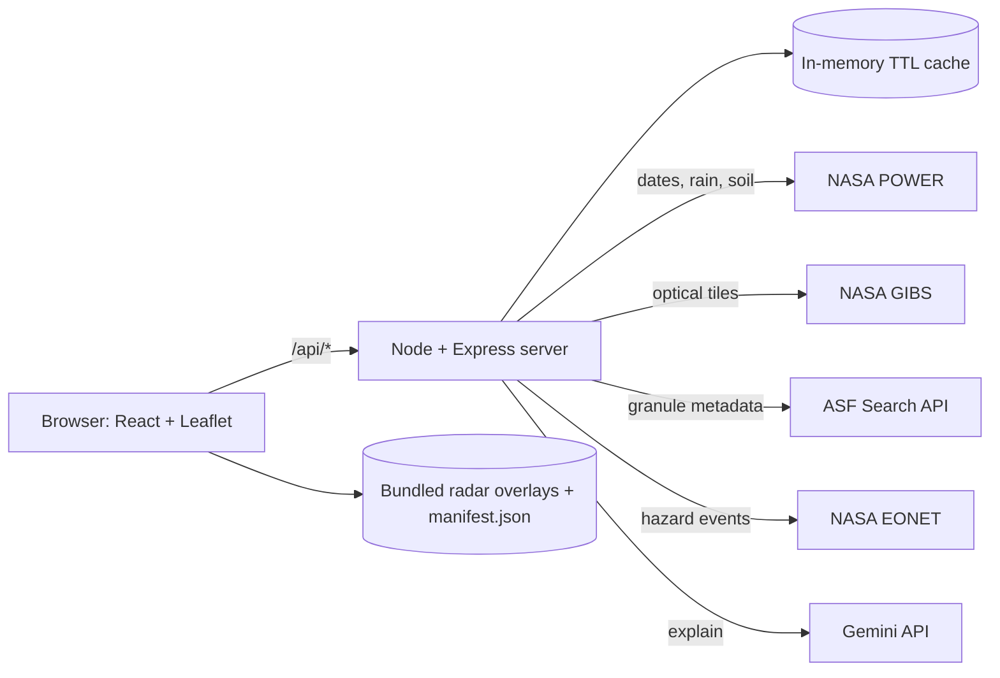

**Live app:** [ADD CLOUD RUN URL HERE]

> Temporary README, written at the start of the hackathon. Sections marked TODO will be completed before the 2:00 PM Sunday freeze.

# NISAR Pulse

*See the Earth change, through clouds and night.*

NASA Space Apps Challenge, Nagpur 2026 (host: Wainganga College of Engineering & Management). Challenge: **Dancing with the SARs**.

## 1. Project Title & Problem Statement

**Project:** NISAR Pulse

**Problem statement (official text):**

> TODO: paste the verbatim challenge text from the Space Apps challenge page.

**In short:** Earth's surface keeps changing through floods, crop cycles and wetness shifts, but optical satellites cannot see through clouds or darkness. Radar can. NISAR Pulse is an open-source web app that lets anyone explore NASA-ISRO NISAR L-band radar over three places (Maharashtra, Northeast India, Japan) and understand what the changes mean.

## 2. Team Details

**Team name:** TODO
**Institution:** TODO

| Name | GitHub | Role |
| --- | --- | --- |
| Aman | [smian087](https://github.com/smian087) | React UI, map, Cloud-Piercer slider |
| Kalash | [kalash-tech](https://github.com/kalash-tech) | Node proxy, ASF / NASA POWER / EONET routes, caching |
| Humaira | [Humairakhan1804](https://github.com/Humairakhan1804) | Radar data preprocessing, overlays, data manifest |
| Asawari | [dhawadasawari1904-hash](https://github.com/dhawadasawari1904-hash) | Gemini explainer, charts, English / Hindi / Marathi text |
| Vedant | [vedantjaiswal-dot](https://github.com/vedantjaiswal-dot) | Story presets, documentation, pitch |

## 3. Solution Overview & Architecture

**What it does (planned P0 features):**

- Area picker for three study areas, with a map showing NISAR radar overlays.
- Date slider to scrub through radar passes, and an HH / HV polarization toggle.
- Cloud-Piercer: a split view comparing optical imagery (NASA GIBS) with radar for the same date and extent.
- Rainfall and soil-wetness chart (NASA POWER) aligned to the radar dates.
- Physics card explaining HH vs HV, surface roughness and the dielectric constant (soil and water moisture).
- AI explainer that suggests physical causes using only the numbers on screen, in English, Hindi and Marathi, with a rule-based fallback.
- Demo Mode that runs on bundled data when the network is down.

**Architecture:**



NISAR radar frames (L-band GCOV, HH and HV) were downloaded from the ASF DAAC and converted on our own laptops into small PNG overlays plus JSON statistics. Raw HDF5 files are not in this repository and are not processed by the server. All external API calls go through the server, which keeps secrets off the browser.

**Tech stack:** React, TypeScript, Tailwind, Vite, Leaflet, Recharts, Zustand, Node.js, Express, zod, Python (h5py, numpy, Pillow, pyproj) for local data preprocessing, Google AI Studio (Build mode), Google Cloud Run.

**Data sources:** NASA-ISRO NISAR via ASF DAAC, NASA GIBS, NASA POWER, NASA EONET, OpenStreetMap and CARTO basemap. This project is not endorsed by NASA.

## 4. Live Demo & Screenshots

- Live app: TODO (same URL as the first line)
- Screenshots: TODO (add after the first working build)

## 5. Installation & Setup Guide

TODO: confirm commands after the first build. Expected:

```bash
git clone <this repo>
cd <repo>
npm install
cp .env.example .env     # add GEMINI_API_KEY, NASA_API_KEY, GEMINI_MODEL
npm run dev
```

Radar overlays are in `public/data/`. To regenerate them from NISAR GCOV files, see `scripts/prep_gcov.py` (requires `h5py numpy pillow pyproj`).

## 6. AI Usage Disclosure

We used AI tools and want to be clear about where and how.

| Tool | Used for |
| --- | --- |
| Claude (Anthropic) | Planning the project, drafting the build prompts, and drafting an early version of the data preprocessing script and this README skeleton |
| Google AI Studio Build (Gemini) | Generating the initial app code from our written specification |
| Gemini API (inside the app) | Runtime feature: explains radar changes from the numbers shown, server-side only |

**What the team did on top:** TODO, to be completed from `AI_USAGE_LEDGER.md` before the freeze. Intended content: choosing the concept and study areas, downloading and preprocessing the NISAR data ourselves, reviewing and testing AI-generated code, integrating the data into the app, and writing commits from our own accounts.

Every commit in this repository is made by a team member from their own GitHub account. No automated commit scripts or AI co-author trailers are used.

---

*Contains data from NASA, ISRO, ASF DAAC and NASA POWER. Not endorsed by NASA.*
